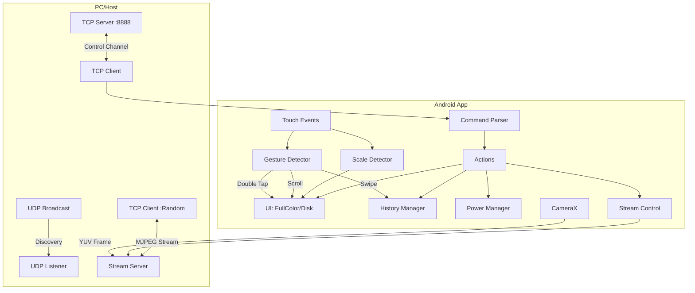

# 开发日记 - ColorPatternGenerator 功能实现记录

## 1. 核心网络通信架构 (TCP/UDP)
**目标**: 实现 App 自动发现与稳定控制。
**方案**:
*   **UDP 发现**: App 在 `UDP 9999` 监听。Client 广播 `hello_pg_0927:IP:PORT`，App 解析后主动发起 TCP 连接。
*   **TCP 控制**: 建立长连接，基于文本行协议 (`\n` 分隔) 进行指令交互。
*   **代码引用**:
    *   [MainActivity.kt](file:///home/ColorPatternGenerator/app/src/main/java/com/example/colorpatterngenerator/MainActivity.kt) 中的 `startUdpListener()` 负责监听。
    *   [MainActivity.kt](file:///home/ColorPatternGenerator/app/src/main/java/com/example/colorpatterngenerator/MainActivity.kt) 中的 `connectTcp()` 负责回连 Client。
    *   [CommandParser.kt](file:///home/ColorPatternGenerator/app/src/main/java/com/example/colorpatterngenerator/CommandParser.kt) 处理 `parse(cmd: String)`。

## 2. 独立端口摄像头串流 (Isolated Stream)
**目标**: 传输 MJPEG 视频流，且不阻塞控制链路。
**方案**:
*   **协商机制**: Client 发送 `stream_start` -> App 启动 `StreamServer` -> 返回 `stream_ready:PORT` -> Client 连接该随机端口。
*   **图像采集**: 使用 CameraX 的 `ImageAnalysis`，配置 `setOutputImageRotationEnabled(true)` 确保方向正确。
*   **YUV 编码**: 针对不同设备兼容性，手动处理 YUV Stride 并转换为 NV21，再压缩为 JPEG。
*   **代码引用**:
    *   [StreamServer.kt](file:///home/ColorPatternGenerator/app/src/main/java/com/example/colorpatterngenerator/StreamServer.kt) 中的 `start()` (绑定随机端口) 和 `sendFrame()` (YUV 处理)。
    *   [MainActivity.kt](file:///home/ColorPatternGenerator/app/src/main/java/com/example/colorpatterngenerator/MainActivity.kt) 中的 `startCameraStream()`。

## 3. 历史记录与手势控制 (History & Gestures)
**目标**: 支持图案切换的撤销/重做，支持光流和触控双重触发。
**方案**:
*   **数据结构**: `HistoryManager` 使用 `ArrayList` + `Index` 指针，实现标准的 Undo/Redo 栈逻辑。
*   **光流手势**: 计算左右区域亮度均值变化，识别挥手方向。
*   **触控手势**: 使用 `GestureDetector.onFling` 识别水平滑动。
    *   **优化**: 限制 `abs(vx) > abs(vy) * 2` 以避免垂直误触；过滤多指操作以避免干扰缩放。
    *   **防误触**: 增加 `maxPointersInGesture` 跟踪和 100ms 持续时间检查，确保单指操作纯净。
*   **代码引用**:
    *   [HistoryManager.kt](file:///home/ColorPatternGenerator/app/src/main/java/com/example/colorpatterngenerator/HistoryManager.kt) 中的 `undo()`, `redo()`, `saveState()`.
    *   [SimpleGestureAnalyzer.kt](file:///home/ColorPatternGenerator/app/src/main/java/com/example/colorpatterngenerator/SimpleGestureAnalyzer.kt) 中的 `analyze()`.
    *   [MainActivity.kt](file:///home/ColorPatternGenerator/app/src/main/java/com/example/colorpatterngenerator/MainActivity.kt) 中的 `gestureDetector` 实现。

## 4. 圆盘全功能交互 (Disk Interaction)
**目标**: 圆盘可缩放、移动，且参数在图案切换间保持。
**方案**:
*   **移动**: `GestureDetector.onScroll` 将像素位移转换为 mm 更新 `diskOffsetYMm`。仅允许双指操作。
*   **缩放**: `ScaleGestureDetector.onScale` 更新 `diskDiameterMm`。
*   **重置**: 识别双指双击 (Double Two-Finger Tap)，重置位置和大小。
*   **冲突解决**: `onTouchEvent` 中优先处理 Scale，缩放进行时拦截 Fling/Scroll。
*   **持久化**: `updateCircleLayout()` 统一使用成员变量更新 UI，确保参数不被重置。
*   **代码引用**:
    *   [MainActivity.kt](file:///home/ColorPatternGenerator/app/src/main/java/com/example/colorpatterngenerator/MainActivity.kt) 中的 `updateCircleLayout()` 和 `scaleDetector`.

## 5. 远程唤醒与休眠 (Remote Power)
**目标**: 黑屏省电但保持网络连接。
**方案**:
*   **Sleep**: 移除 `FLAG_KEEP_SCREEN_ON`，亮度设为 0.01，显示全黑界面，申请 `PARTIAL_WAKE_LOCK` 和 `WifiLock`。
*   **Wake**: 恢复 `FLAG_KEEP_SCREEN_ON` 和亮度，释放锁，并自动恢复之前的图案。
*   **代码引用**:
    *   [MainActivity.kt](file:///home/ColorPatternGenerator/app/src/main/java/com/example/colorpatterngenerator/MainActivity.kt) 中的 `Command.Sleep` / `Command.Wake` 处理逻辑。

## 6. 系统架构图 (Architecture)

